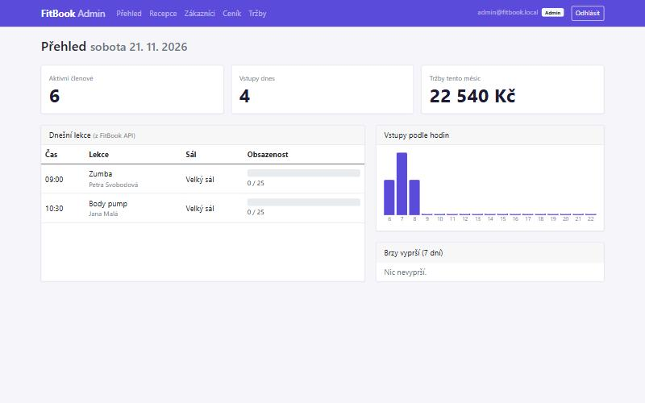
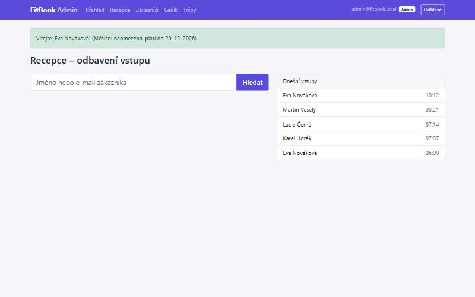
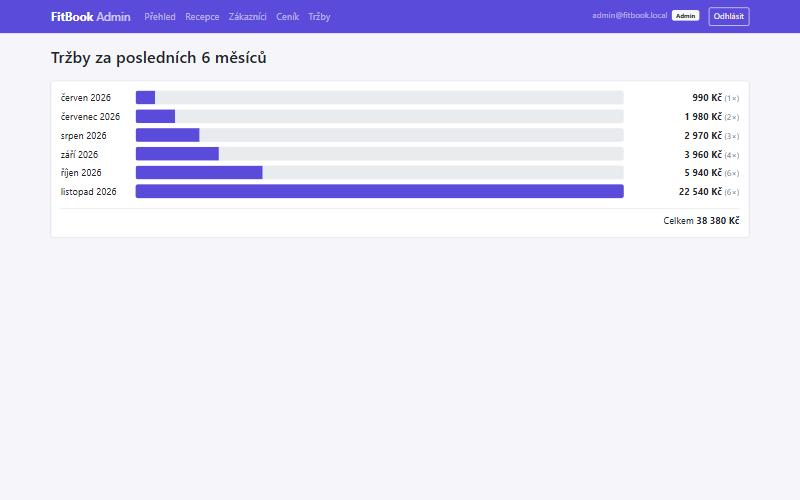

# FitBook Admin

[](https://github.com/neubauerlukas207-cell/fitbook-admin/actions/workflows/ci.yml)

**Administrace fitness centra pro recepci a vedení** – prodej permanentek, odbavení vstupů, přehled dne a tržby. ASP.NET Core 8 MVC, Entity Framework Core, ASP.NET Core Identity s rolemi, xUnit.

Součást ekosystému **FitBook** – dnešní lekce načítá živě z mé Java služby [fitbook-api](https://github.com/neubauerlukas207-cell/fitbook-api).

| Přehled dne | Recepce | Tržby |
|---|---|---|
|  |  |  |

## Funkce

- **Recepce** – vyhledání zákazníka a odbavení vstupu jedním kliknutím. Aplikace sama vybere správnou permanentku (přednost má neomezená, pak ta, co nejdřív vyprší), u permanentky na vstupy odečte vstup a ignoruje opakované pípnutí do hodiny.
- **Prodej permanentek** – měsíční/roční neomezené a permanentky na vstupy. Prodloužení navazuje na stávající platnost, takže zákazník nepřijde o zaplacené dny.
- **Přehled dne** – aktivní členové, dnešní vstupy po hodinách, tržby za měsíc, permanentky, které brzy vyprší, a dnešní lekce z FitBook API (když API neběží, zbytek funguje dál).
- **Role** – *Recepce* (odbavení, prodej, zákazníci) a *Admin* (navíc ceník a tržby). Veřejná registrace je vypnutá, účty zakládá admin.
- **Tržby** za posledních 6 měsíců.

## Technologie

C# 12 · .NET 8 · ASP.NET Core MVC + Razor · Entity Framework Core 8 (SQLite, migrace) · ASP.NET Core Identity · Bootstrap 5 · xUnit · WebApplicationFactory · Docker · GitHub Actions

## Spuštění

```bash
dotnet run --project src/FitBook.Admin
```

Ve vývojovém režimu se vytvoří databáze s ukázkovými daty a dva účty (heslo pro oba: `FitBook-Demo-2026`, jen pro lokální demo):

| E-mail | Role |
|---|---|
| `admin@fitbook.local` | Admin |
| `recepce@fitbook.local` | Recepce |

Pro rozvrh lekcí na přehledu spusťte vedle i [fitbook-api](https://github.com/neubauerlukas207-cell/fitbook-api) (port 8080).

**Docker:**

```bash
# demo s ukázkovými daty
docker run -p 8080:8080 -e Demo__Password=FitBook-Demo-2026 ghcr.io/neubauerlukas207-cell/fitbook-admin

# produkčně: první admin z proměnných prostředí, databáze ve svazku
docker run -p 8080:8080 -v fitbook-data:/data \
  -e Bootstrap__AdminEmail=admin@example.com -e Bootstrap__AdminPassword='...' \
  -e FitBookApi__BaseUrl=http://fitbook-api:8080 \
  ghcr.io/neubauerlukas207-cell/fitbook-admin
```

**Testy:** `dotnet test` – 30 testů:

- **pravidla** (prodej, odbavení, reporty) nad skutečnou SQLite databází v paměti s „posouvatelnými hodinami“ (`TimeProvider`),
- **integrační testy** celé aplikace přes `WebApplicationFactory` – přihlášení, role, anti-forgery tokeny a celý průběh recepce přes formuláře.

## Struktura

```
src/FitBook.Admin/
  Domain/        entity: MembershipPlan, Customer, Membership, CheckIn
  Data/          DbContext (EF Core), migrace, seed (role, ceník, demo data)
  Services/      MembershipService, CheckInService, ReportService, BusinessClock, FitBookApiClient
  Controllers/   Home (přehled), CheckIn (recepce), Customers, Plans, Reports
  Views/         Razor šablony
tests/FitBook.Admin.Tests/
```

